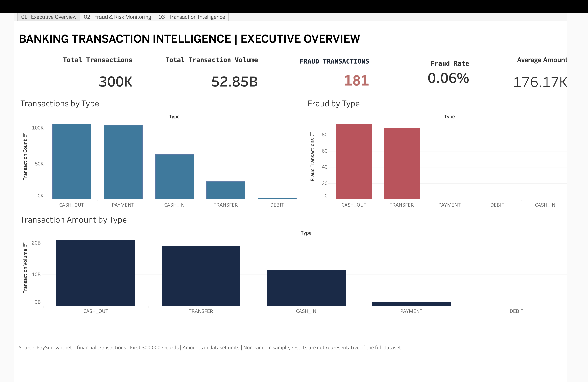
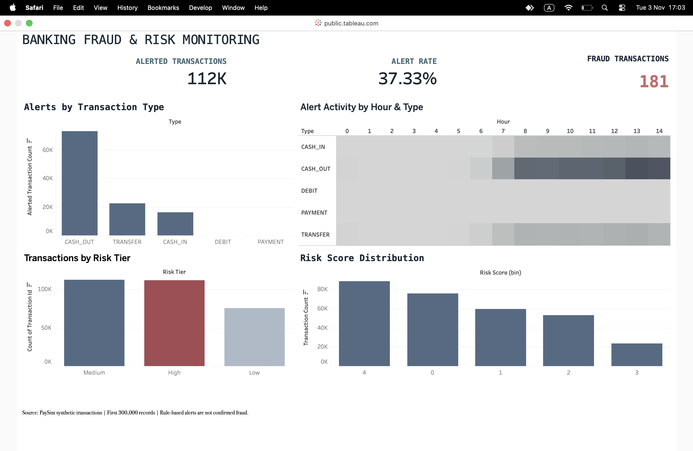
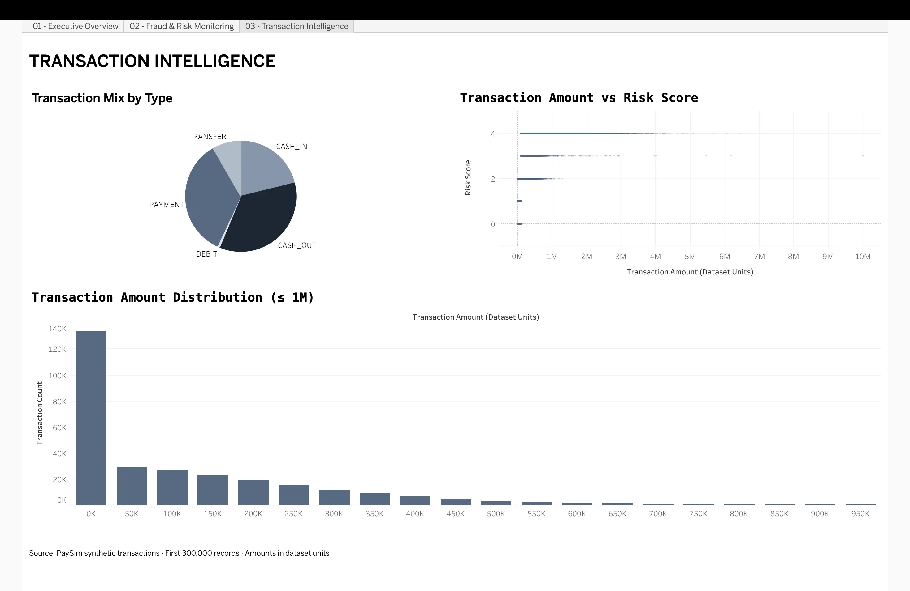

# Banking Fraud & Transaction Intelligence

**Python · Pandas · SQL (SQLite) · Tableau**

[**Explore the live Tableau dashboards**](https://public.tableau.com/app/profile/tsovinar.harutyunyan/viz/BankingFraudTransactionIntelligence/01-ExecutiveOverview)

A transaction-monitoring portfolio project built to answer two questions: **Where do simulated fraud labels appear in transaction activity?** And **how useful are simple, explainable rules for identifying transactions that need review?**

I explored transaction patterns with Python, checked summaries with SQL, tested a transparent risk-scoring approach, and built three Tableau dashboards to communicate the results. A central part of the analysis is measuring the **workload created by false alerts**, rather than presenting an alert as confirmed fraud.

## Data and scope

- **Source:** [PaySim — synthetic financial transactions](https://www.kaggle.com/datasets/ealaxi/paysim1).
- **Sample:** The **first 300,000 rows** of the supplied CSV, not a random sample of the full dataset.
- **Privacy:** Simulated account IDs and transactions; **no actual customer or bank data**.
- **Amounts:** PaySim dataset units; no real-world currency is assumed.
- **Time:** `step` is a **simulation hour**. Derived day and hour values do not represent verified calendar timestamps.

## Results at a glance

| Measure | Result |
|---|---:|
| Transactions analyzed | **300,000** |
| Total transaction amount | **52.85 billion** dataset units |
| Transactions labeled as fraud | **181** |
| Labeled fraud rate | **0.0603%** |
| Transactions flagged by my rules | **112,004** |
| Alert rate | **37.33%** |
| Labeled fraud cases flagged | **87** |
| Labeled fraud cases missed | **94** |
| Recall | **48.07%** |
| Alert precision | **0.078%** |
| Alerts without a fraud label | **111,917** |

*Figures come from the included, executed notebook for this specific PaySim extract.*

### Finding 1 — Count and rate tell different stories

| Transaction type | Transactions | Labeled fraud | Labeled fraud rate |
|---|---:|---:|---:|
| CASH_OUT | 105,401 | 93 | 0.0882% |
| TRANSFER | 24,905 | 88 | 0.3533% |
| CASH_IN | 63,408 | 0 | 0% |
| PAYMENT | 104,056 | 0 | 0% |
| DEBIT | 2,230 | 0 | 0% |

**CASH_OUT** contains slightly more labeled fraud cases than **TRANSFER** (93 versus 88), but the **TRANSFER** fraud-label rate is about **four times higher** in this extract. Looking only at fraud counts would obscure that difference.

The zero counts in the other types are properties of this **synthetic sample**, not a claim that those payment types are safe in the real world.

### Finding 2 — High alert volume does not mean good detection

I constructed an **illustrative rule-based score**, not a predictive model or bank policy:

| Indicator | Illustrative score |
|---|---:|
| Amount at least 100,000 dataset units | +2 |
| Amount greater than sender's recorded pre-transaction balance | +1 |
| Transaction type is TRANSFER or CASH_OUT | +1 |
| **Alert threshold** | **Score ≥ 3** |

The rule uses transaction information available before or at the transaction, **not `isFraud`**, to calculate risk. The synthetic fraud label is used **only to evaluate** the alerts.

**Comparison with the dataset labels:**

| | No rule alert | Rule alert |
|---|---:|---:|
| No fraud label | 187,902 | 111,917 |
| Fraud label | 94 | 87 |

The rules flagged **37.33% of all transactions**, yet caught fewer than half of the 181 labeled fraud cases. Just **0.078% of alerts** corresponded to a fraud label. This is a poor balance of detection and review workload and **should not be deployed as-is**.

The recorded-balance indicator is especially tentative: an amount larger than the pre-transaction balance may represent insufficient funds or a simulation artifact, **not fraud**. Thresholds were chosen to demonstrate an interpretable process, not optimized or validated with banking data.

**Business takeaway:** A fraud-monitoring process should be evaluated on **recall, precision, alert rate, and investigation capacity**, not on the number of alerts alone.

## Tableau dashboards

The [published Tableau workbook](https://public.tableau.com/app/profile/tsovinar.harutyunyan/viz/BankingFraudTransactionIntelligence/01-ExecutiveOverview) contains three pages:

**01 — Executive Overview** · Transaction volume and amount, fraud-label KPIs, and comparisons by transaction type.



**02 — Fraud & Risk Monitoring** · Rule-alert KPIs, alert activity by simulated hour and type, risk tiers, and score distribution.



**03 — Transaction Intelligence** · Transaction mix, amount versus risk score, and transaction amount distribution (histogram limited to amounts ≤ 1 million dataset units).



The published dashboards use the transaction-level export **`tableau/transactions_dashboard.csv`**. Five additional CSV exports are generated for further analysis; **the existing three dashboard pages do not require five more data-source connections**.

## Project workflow

1. **Validate:** inspect required columns, missing values, and exact duplicates before analysis.
2. **Explore:** aggregate counts, transaction amounts, and labeled fraud rates by type.
3. **Score:** apply explicit rule indicators and assign Low / Medium / High review tiers.
4. **Evaluate:** compare rule alerts with `isFraud`; report caught cases, missed cases, non-fraud-labeled alerts, recall, and precision.
5. **Cross-check with SQL:** query transaction summaries using SQLite.
6. **Visualize:** export prepared data and present results in Tableau.

`isFraud` = PaySim's synthetic fraud label; `isFlaggedFraud` = PaySim's pre-existing flag; `rule_alert` = the separate illustrative alert created in this project. **These are not interchangeable.**

## Repository files

| Path | Purpose |
|---|---|
| [`Banking_Fraud_Intelligence.ipynb`](Banking_Fraud_Intelligence.ipynb) | Main, executed Python notebook with analysis and interpretations |
| [`src/analysis.py`](src/analysis.py) | Optional reusable command-line pipeline |
| [`sql/`](sql/) | Seven example SQL analyses for the command-line pipeline |
| [`requirements.txt`](requirements.txt) | Python dependencies |
| [`RUN_ME_FIRST.md`](RUN_ME_FIRST.md) | Local setup steps |
| [`TABLEAU_BUILD_GUIDE.md`](TABLEAU_BUILD_GUIDE.md) | Description of the finished Tableau dashboards |
| `executive-overview.png`, `fraud-risk-monitoring.png`, `transaction-intelligence.png` | Dashboard preview images |
| `data/`, `tableau/`, `outputs/` | Local input and generated files; not committed to Git |

The notebook writes six local Tableau CSVs: `transactions_dashboard.csv`, `type_metrics.csv`, `daily_metrics.csv`, `risk_heatmap.csv`, `accounts.csv`, and `transaction_types.csv`. It also creates a local SQLite summary. The small, additional CSVs are prepared outputs, **not independent data sources for the published dashboards**.

## Run locally

Download the [PaySim CSV](https://www.kaggle.com/datasets/ealaxi/paysim1), then place `PS_20174392719_1491204439457_log.csv` at `data/PS_20174392719_1491204439457_log.csv`.

```bash
pip install -r requirements.txt
jupyter notebook Banking_Fraud_Intelligence.ipynb
```

Run **Restart & Run All** from the repository's root folder. The notebook reads the first **300,000** rows and creates `tableau/` and `outputs/` exports. Connect Tableau Desktop to the generated `tableau/transactions_dashboard.csv` when working with a local copy.

Alternatively, use the separate CLI pipeline, which also runs additional SQL queries:

```bash
python src/analysis.py --input "data/PS_20174392719_1491204439457_log.csv" --limit 300000
```

For a quick functionality check without PaySim, `python src/analysis.py --demo` creates a **different, explicitly labeled demo dataset**. Do not compare its results to the PaySim numbers above.

## Limitations and next steps

- The sample is **nonrandom and synthetic**, so results must not be generalized to real-world fraud rates.
- A review alert is **not** evidence of confirmed fraud, and account IDs do not necessarily identify unique individuals.
- The risk thresholds are illustrative; the rules have not been calibrated, benchmarked, or tested for use in a bank.
- The first 300,000 rows cover a narrow simulation period, so this extract cannot support meaningful long-term or day-over-day trend conclusions.
- Next steps would be to test alternative thresholds and better-supported behavior indicators, compare **precision–recall and alert burden**, and validate on appropriate holdout data before considering operational use.

**Project by Tsovinar Harutyunyan · [Live Tableau workbook](https://public.tableau.com/app/profile/tsovinar.harutyunyan/viz/BankingFraudTransactionIntelligence/01-ExecutiveOverview)**
